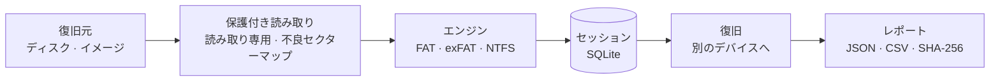

<div align="center">


# Rescyo レスキオ

**ディスクに一切書き込まない、無料のオープンソース・データ復旧ツール。**

[](https://github.com/akk0sfx/Rescyo/actions/workflows/ci.yml)
[](LICENSE)
[](docs/roadmap.md)
[](#対応プラットフォーム)
[](rust-toolchain.toml)

[English](README.md) · [Русский](README.ru.md) · [简体中文](README.zh-CN.md) · **日本語** · [한국어](README.ko.md)

[クイックスタート](#クイックスタート) · [Rescyo の特長](#rescyo-の特長) · [しくみ](#しくみ) · [ファイルシステム](#ファイルシステム) · [ロードマップ](docs/roadmap.md)

</div>

---

> この翻訳は機械支援による下訳で、ネイティブによる校正待ちです。改善の提案を歓迎します。

Rescyo は、破損・フォーマット済み・一部読み取り不能になったディスク、メモリーカード、USB メモリからファイルを取り戻します。ファイル数の制限なしにフォルダーツリー全体を復旧し、各ファイルがどう組み立てられたか、内容の検証に合格したかを示し、劣化したディスクを丁寧に扱います。単一のポータブル実行ファイルで Windows 7–11、Linux、macOS に対応し、CLI は安定した JSON を出力します。

DMDE、R-Studio、UFS Explorer の無料オープンソース代替ソフトです。

> [!IMPORTANT]
> **アルファ版（v0.2）。** コマンドラインで FAT、exFAT、NTFS（圧縮ファイルと代替データストリームを含む）を復旧でき、故障しかけたディスクを ddrescue 互換のマップ付きでイメージ化し、失われたパーティションを検出できます。バイト単位の復旧テストに合格していますが、署名付きバイナリはまだありません。必ず別のディスクに復旧し、故障しかけたディスクは先にイメージを取得してください。

## Rescyo の特長

<table>
<tr>
<td width="50%" valign="top">

**設計段階から読み取り専用**<br>
復旧元のディスクは読み取り専用で開かれ、型システムがそれを保証します（I/O 層に書き込み操作はありません）。同じ物理デバイスへの保存はドライブ文字ではなくデバイス単位で拒否されます。

</td>
<td width="50%" valign="top">

**ファイルごとに正直に**<br>
各ファイルについて、組み立て方法（FAT チェーン、ミラー FAT、MFT ランリスト、または「連続」と仮定）と内容の検証結果を表示します。中身が壊れたファイルが正常なファイルと同じに見えることはありません。

</td>
</tr>
<tr>
<td valign="top">

**劣化したメディアをいたわる**<br>
読み取れないセクターは一度だけ読み、不良セクターマップに記録して二度と読み直しません。劣化を検知すると一時停止し、先にイメージを取得するよう案内します。

</td>
<td valign="top">

**フォルダーツリー全体を無制限に**<br>
親フォルダーが壊れたフォルダーも含めて一度に復旧します（`_LOST_FOLDERS` に配置）。DMDE のスキャンログを取り込めば、何時間もの再スキャンが不要です。

</td>
</tr>
</table>

## クイックスタート

まだリリースされていません。ソースからビルドするには：

```sh
git clone https://github.com/akk0sfx/Rescyo.git
cd Rescyo
cargo build --release
```

コマンドの例：

```sh
rescyo disks --json                              # ディスク一覧
rescyo scan /dev/sdb --session flash.db          # ボリュームとフォルダーを検出（読み取り専用）
rescyo image /dev/sdb --to /mnt/backup/flash.img  # 故障しかけたディスク：まずイメージ化（再開可能）
rescyo partitions /dev/sdb                       # テーブルにないパーティションを検出
rescyo ls flash.db --deleted --ext jpg,docx      # 見つかったファイルを閲覧
rescyo recover flash.db --to /mnt/backup/flash   # SHA-256 レポート付きで書き出し
```

## しくみ



## ファイルシステム

| ファイルシステム | 対応範囲 | バージョン |
|---|---|---|
| FAT12、FAT16、FAT32 | 完全：失われたボリューム、フォルダーツリー、削除済みファイル | v0.1 |
| exFAT | 完全 | v0.1 |
| NTFS | 完全：MFT、削除済みファイル、スパースファイル。圧縮（LZNT1）・WOF 圧縮（XPRESS、LZX）ファイルと代替データストリームは v0.2 から | v0.1 |
| ext4、HFS+、APFS、Btrfs | 実験的 | v0.3–v0.4 |

## 対応プラットフォーム

| OS | アーキテクチャ |
|---|---|
| Windows 10 / 11 | x64、arm64 |
| Windows 7 SP1 | x64、x86（専用ビルド） |
| Linux | x86_64、i686、aarch64、armv7、riscv64、loongarch64 |
| macOS 10.12+ | Apple シリコン、Intel |

## ライセンス

GPL-3.0-or-later。[LICENSE](LICENSE) を参照してください。本プログラムは無保証です。

本プロジェクトは DMDE Software、R-Tools Technology、SysDev Laboratories とは一切関係ありません。DMDE、R-Studio、UFS Explorer は各所有者の商標です。
