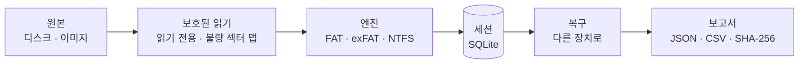

<div align="center">


# Rescyo 레스키오

**디스크에 절대 쓰지 않는 무료 오픈 소스 데이터 복구 도구.**

[](https://github.com/akk0sfx/Rescyo/actions/workflows/ci.yml)
[](LICENSE)
[](docs/roadmap.md)
[](#지원-플랫폼)
[](rust-toolchain.toml)

[English](README.md) · [Русский](README.ru.md) · [简体中文](README.zh-CN.md) · [日本語](README.ja.md) · **한국어**

[빠른 시작](#빠른-시작) · [Rescyo를 쓰는 이유](#rescyo를-쓰는-이유) · [동작 방식](#동작-방식) · [파일 시스템](#파일-시스템) · [로드맵](docs/roadmap.md)

</div>

---

> 이 번역은 기계 지원 초벌 번역이며 원어민 검수를 기다리고 있습니다. 개선 제안을 환영합니다.

Rescyo는 손상되었거나 포맷되었거나 일부를 읽을 수 없는 디스크, 메모리 카드, USB 플래시 드라이브에서 파일을 되찾습니다. 파일 개수 제한 없이 폴더 트리 전체를 복구하고, 각 파일이 어떻게 조립되었는지와 내용 검증 결과를 알려 주며, 죽어 가는 디스크를 조심스럽게 다룹니다. 하나의 포터블 실행 파일로 Windows 7–11, Linux, macOS에서 동작하며 CLI는 안정적인 JSON을 출력합니다.

DMDE, R-Studio, UFS Explorer의 무료 오픈 소스 대안입니다.

> [!WARNING]
> **프리알파.** 아직 릴리스가 없습니다. v0.1.0이 바이트 단위 복구 검증을 통과하기 전에는 중요한 데이터에 사용하지 마십시오.

## Rescyo를 쓰는 이유

<table>
<tr>
<td width="50%" valign="top">

**설계부터 읽기 전용**<br>
복구 대상 디스크는 읽기 전용으로 열리며 타입 시스템이 이를 보장합니다(I/O 계층에는 쓰기 연산이 없습니다). 같은 물리 장치에 저장하는 것은 드라이브 문자가 아니라 장치 단위로 거부됩니다.

</td>
<td width="50%" valign="top">

**파일마다 정직하게**<br>
각 파일이 어떻게 조립되었는지(FAT 체인, 미러 FAT, MFT 런리스트, 또는 "연속" 추정)와 내용 검증 결과를 표시합니다. 쓰레기 데이터로 찬 파일이 정상 파일처럼 보이는 일은 없습니다.

</td>
</tr>
<tr>
<td valign="top">

**죽어 가는 매체를 아낍니다**<br>
읽을 수 없는 섹터는 한 번만 읽고 불량 섹터 맵에 기록하며 다시 읽지 않습니다. 디스크 상태가 나빠지면 일시 정지하고 먼저 이미지를 만들라고 안내합니다.

</td>
<td valign="top">

**폴더 트리 전체, 제한 없이**<br>
상위 폴더가 손상된 폴더까지 한 번에 복구합니다(`_LOST_FOLDERS`에 배치). DMDE 스캔 로그를 가져오면 몇 시간짜리 재스캔이 필요 없습니다.

</td>
</tr>
</table>

## 빠른 시작

아직 릴리스되지 않았습니다. 소스에서 빌드하려면:

```sh
git clone https://github.com/akk0sfx/Rescyo.git
cd Rescyo
cargo build --release
```

계획된 v0.1 명령:

```sh
rescyo disks --json                              # 디스크 목록
rescyo scan /dev/sdb --session flash.db          # 볼륨과 폴더 찾기(읽기 전용)
rescyo ls flash.db --deleted --ext jpg,docx      # 찾은 항목 보기
rescyo recover flash.db --to /mnt/backup/flash   # SHA-256 보고서와 함께 복사
```

## 동작 방식



## 파일 시스템

| 파일 시스템 | 지원 범위 | 버전 |
|---|---|---|
| FAT12, FAT16, FAT32 | 전체: 손실된 볼륨, 폴더 트리, 삭제된 파일 | v0.1 |
| exFAT | 전체 | v0.1 |
| NTFS | 전체: MFT, 삭제된 파일. 압축·스파스·ADS는 v0.2 | v0.1 |
| ext4, HFS+, APFS, Btrfs | 실험적 | v0.3–v0.4 |

## 지원 플랫폼

| OS | 아키텍처 |
|---|---|
| Windows 10 / 11 | x64, arm64 |
| Windows 7 SP1 | x64, x86 (별도 빌드) |
| Linux | x86_64, i686, aarch64, armv7, riscv64, loongarch64 |
| macOS 10.12+ | Apple 실리콘, Intel |

## 라이선스

GPL-3.0-or-later. [LICENSE](LICENSE)를 참고하십시오. 이 프로그램은 어떠한 보증도 제공하지 않습니다.

본 프로젝트는 DMDE Software, R-Tools Technology, SysDev Laboratories와 관련이 없으며, DMDE, R-Studio, UFS Explorer는 각 소유자의 상표입니다.
