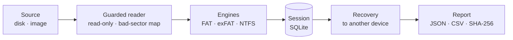

<div align="center">


# Rescyo

**Free, open-source data recovery that never writes to your disk.**

[](https://github.com/akk0sfx/Rescyo/actions/workflows/ci.yml)
[](LICENSE)
[](docs/roadmap.md)
[](#platforms)
[](rust-toolchain.toml)
[](CONTRIBUTING.md#safety-rules)

**English** · [Русский](README.ru.md) · [简体中文](README.zh-CN.md) · [日本語](README.ja.md) · [한국어](README.ko.md)

[Quick start](#quick-start) · [Why Rescyo](#why-rescyo) · [How it works](#how-it-works) · [File systems](#file-systems) · [Roadmap](docs/roadmap.md) · [FAQ](#faq)

</div>

---

Rescyo brings back files from damaged, formatted or partially unreadable disks, memory cards and USB flash drives. It rebuilds whole folder trees with no file-count limits, tells you how every file was reassembled and whether its content checks out, and treats a dying disk gently. One portable binary for Windows 7–11, Linux and macOS, with a CLI that speaks stable JSON.

Free open-source alternative to DMDE, R-Studio and UFS Explorer.

> [!IMPORTANT]
> **Alpha (v0.3).** The command line recovers FAT, exFAT and NTFS (including compressed files and alternate data streams), images failing disks with a ddrescue-compatible map and finds lost partitions; it passes its byte-for-byte test gate, but there are no signed binaries yet. Always recover to a different disk, and image a failing disk before anything else. Since v0.3 it also reads VHD, VHDX, VMDK, qcow2 and E01 images, carves files by their signatures, reads ext4 (experimental) and has a terminal interface.

## Why Rescyo

<table>
<tr>
<td width="50%" valign="top">

**Read-only by design**<br>
The disk you recover from is opened read-only, enforced by the type system: the I/O layer has no write operation. Saving to the same physical device is refused, checked by device, not by drive letter.

</td>
<td width="50%" valign="top">

**Honest about every file**<br>
Each file says how it was assembled (FAT chain, mirror FAT, MFT runlist, or a contiguous guess) and whether its content verifies. A file full of garbage never looks the same as a good one.

</td>
</tr>
<tr>
<td valign="top">

**Gentle with dying media**<br>
Unreadable sectors are read once, recorded in a bad-sector map and never hammered again. When a disk degrades, Rescyo pauses and tells you to image it first.

</td>
<td valign="top">

**Whole folder trees, no limits**<br>
Recover everything at once, including folders whose parents are destroyed (they land in `_LOST_FOLDERS`). Import a DMDE scan log to skip hours of rescanning.

</td>
</tr>
<tr>
<td valign="top">

**Automation first**<br>
Everything the GUI will do is available from the CLI, with versioned JSON, stable error codes and streaming progress. An MCP server for AI agents is planned for v1.0.

</td>
<td valign="top">

**Hardened against hostile disks**<br>
Parsers contain no `unsafe`, bound every loop, recursion and allocation, and are fuzzed continuously, because a crafted image must not crash or compromise a tool running as administrator.

</td>
</tr>
</table>

## Quick start

No signed binaries yet: build from source (Rust 1.99), or take the unsigned artifacts of the latest [Build run](https://github.com/akk0sfx/Rescyo/actions/workflows/build.yml).

```sh
git clone https://github.com/akk0sfx/Rescyo.git
cd Rescyo
cargo build --release
```

Then, on a disk or an image (reading disks needs administrator or root rights):

```sh
rescyo disks --json                              # list disks
rescyo scan /dev/sdb --session flash.db          # find volumes and folders (read-only)
rescyo image /dev/sdb --to /mnt/backup/flash.img  # failing disk: image it first (resumable)
rescyo partitions /dev/sdb                       # find partitions missing from the table
rescyo tui flash.db                              # browse and recover in the terminal
rescyo scan /dev/sdb --session flash.db --deep   # also look for lost volumes and folders
rescyo ls flash.db --deleted --ext jpg,docx      # browse what was found
rescyo recover flash.db --to /mnt/backup/flash   # copy out, with a SHA-256 report
rescyo import-dmde devscan.log --source /dev/sdb --session flash.db
```

<!--
## Screenshots

<table>
<tr>
<td width="50%"><br><b>Browse.</b> Every file shows how it was assembled and whether it verifies.</td>
<td width="50%"><br><b>Scan.</b> The sector strip shows readable and damaged areas live.</td>
</tr>
</table>
-->

## How it works



A **Scan** finds volume candidates (partition tables, boot sectors and their backups, allocation-table signatures, directory starts) and fills a **Session**: every file and folder with the exact bytes it is made of. **Recovery** copies those bytes to a different device after a full preflight check of space, names and path limits. Vocabulary is defined in [CONTEXT.md](CONTEXT.md); design decisions are recorded in [docs/adr](docs/adr).

## File systems

| File system | Depth | Since |
|---|---|---|
| FAT12, FAT16, FAT32 | Full: lost volumes, folder trees, deleted files | v0.1 |
| exFAT | Full | v0.1 |
| NTFS | Full: MFT, deleted files, sparse files; compressed (LZNT1) and WOF-compressed (XPRESS, LZX) files and alternate data streams since v0.2 | v0.1 |
| ext2, ext3, ext4 | Experimental: intact read; deleted files where metadata remains (recent Linux wipes it: use carving) | v0.3 |
| HFS+, APFS, Btrfs | Experimental | v0.4 |
| ReFS | Planned | v2 |

## Platforms

| OS | Architectures | Notes |
|---|---|---|
| Windows 10 / 11 | x64, arm64 | |
| Windows 7 SP1 | x64, x86 | separate legacy build |
| Linux | x86_64, i686, aarch64, armv7, riscv64, loongarch64 | static musl binaries for live-USB |
| macOS 10.12+ | Apple silicon, Intel | universal binary |

## FAQ

<details>
<summary><b>Will Rescyo modify my disk?</b></summary>

No. The source is opened without write access, the I/O layer has no write operation, and recovered files cannot be saved to the same physical device. If the destination's device cannot be determined, Rescyo refuses unless you explicitly override it.
</details>

<details>
<summary><b>My disk makes clicking noises or shows read errors. What should I do?</b></summary>

Stop using it, do not run repeated scans, and image it first (Rescyo will do this from v0.2; until then GNU ddrescue works). Rescyo reads each bad sector only once and pauses automatically when errors pile up.
</details>

<details>
<summary><b>Can it recover files deleted from an SSD?</b></summary>

Usually not: with TRIM enabled the drive erases deleted blocks itself. Rescyo will say so instead of scanning for hours.
</details>

<details>
<summary><b>I already scanned the disk with DMDE. Do I have to scan again?</b></summary>

No. `rescyo import-dmde devscan.log` reuses DMDE's volume geometry and folder list as hints, verifies each one on the disk, and recovers whole folder trees at once.
</details>

## Contributing

Contributions are welcome under the Developer Certificate of Origin. Start with [CONTRIBUTING.md](CONTRIBUTING.md): clean-room rules, safety rules and the branch workflow. Report vulnerabilities privately as described in [SECURITY.md](SECURITY.md).

<!--
## Star history

<a href="https://star-history.com/#akk0sfx/Rescyo&Date">
  <picture>
    <source media="(prefers-color-scheme: dark)" srcset="https://api.star-history.com/svg?repos=akk0sfx/Rescyo&type=Date&theme=dark">
    
  </picture>
</a>
-->

## License

GPL-3.0-or-later, see [LICENSE](LICENSE). This program comes with ABSOLUTELY NO WARRANTY; recovery outcomes depend on the state of the medium.

Not affiliated with DMDE Software, R-Tools Technology or SysDev Laboratories. DMDE, R-Studio and UFS Explorer are trademarks of their respective owners.
