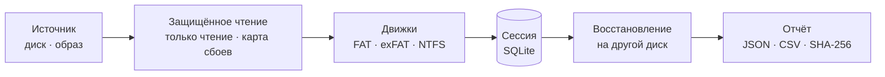

<div align="center">


# Rescyo

**Бесплатное восстановление данных с открытым кодом, которое никогда не пишет на ваш диск.**

[](https://github.com/akk0sfx/Rescyo/actions/workflows/ci.yml)
[](LICENSE)
[](docs/roadmap.md)
[](#платформы)
[](rust-toolchain.toml)
[](CONTRIBUTING.md#safety-rules)

[English](README.md) · **Русский** · [简体中文](README.zh-CN.md) · [日本語](README.ja.md) · [한국어](README.ko.md)

[Быстрый старт](#быстрый-старт) · [Почему Rescyo](#почему-rescyo) · [Как это работает](#как-это-работает) · [Файловые системы](#файловые-системы) · [Дорожная карта](docs/roadmap.md) · [Вопросы](#вопросы)

</div>

---

Rescyo возвращает файлы с повреждённых, отформатированных и частично нечитаемых дисков, карт памяти и флешек. Восстанавливает целые деревья папок без ограничений на число файлов, говорит про каждый файл, как он собран и проверено ли его содержимое, и бережно обращается с умирающим диском. Один портативный файл для Windows 7–11, Linux и macOS и CLI со стабильным JSON.

Бесплатная open-source альтернатива DMDE, R-Studio и UFS Explorer.

> [!IMPORTANT]
> **Альфа (v0.3).** Командная строка восстанавливает FAT, exFAT и NTFS (включая сжатые файлы и альтернативные потоки), снимает образ с умирающего диска с картой в формате ddrescue и находит потерянные разделы; она проходит проверку побайтного восстановления, но подписанных сборок пока нет. Всегда восстанавливайте на другой диск, а умирающий диск сначала снимайте в образ. С v0.3 она также читает образы VHD, VHDX, VMDK, qcow2 и E01, находит файлы по сигнатурам, читает ext4 (экспериментально) и работает в терминальном интерфейсе.

## Почему Rescyo

<table>
<tr>
<td width="50%" valign="top">

**Только чтение — по устройству программы**<br>
Диск, с которого восстанавливают, открывается только на чтение, и это гарантирует система типов: у слоя ввода-вывода нет операции записи. Сохранить файлы на то же физическое устройство нельзя — проверка по устройству, а не по букве диска.

</td>
<td width="50%" valign="top">

**Честно про каждый файл**<br>
У каждого файла указано, как он собран (цепочка FAT, зеркальная FAT, runlist MFT или предположение «непрерывно»), и прошла ли проверка содержимого. Файл с мусором никогда не выглядит так же, как целый.

</td>
</tr>
<tr>
<td valign="top">

**Бережно с умирающими носителями**<br>
Нечитаемый сектор читается один раз, попадает в карту плохих секторов и больше не мучается. Если диск деградирует, Rescyo останавливается и предлагает сначала снять образ.

</td>
<td valign="top">

**Целые деревья папок без лимитов**<br>
Всё сразу, включая папки с разрушенным родителем (они попадают в `_LOST_FOLDERS`). Импорт скана DMDE избавляет от многочасового повторного сканирования.

</td>
</tr>
<tr>
<td valign="top">

**Автоматизация в первую очередь**<br>
Всё, что будет уметь GUI, доступно из CLI: версионированный JSON, стабильные коды ошибок, потоковый прогресс. MCP-сервер для AI-агентов — в v1.0.

</td>
<td valign="top">

**Защита от враждебных дисков**<br>
В парсерах нет `unsafe`, каждый цикл, рекурсия и выделение памяти ограничены, всё непрерывно фаззится: специально собранный образ не должен уронить или взломать программу, работающую с правами администратора.

</td>
</tr>
</table>

## Быстрый старт

Подписанных сборок пока нет: соберите из исходников (Rust 1.99) или возьмите неподписанные артефакты последнего [запуска Build](https://github.com/akk0sfx/Rescyo/actions/workflows/build.yml).

```sh
git clone https://github.com/akk0sfx/Rescyo.git
cd Rescyo
cargo build --release
```

Затем, для диска или образа (чтение дисков требует прав администратора или root):

```sh
rescyo disks --json                              # список дисков
rescyo scan /dev/sdb --session flash.db          # найти тома и папки (только чтение)
rescyo image /dev/sdb --to /mnt/backup/flash.img  # умирающий диск: сначала образ (с продолжением)
rescyo partitions /dev/sdb                       # найти разделы, которых нет в таблице
rescyo tui flash.db                              # обзор и восстановление в терминале
rescyo scan /dev/sdb --session flash.db --deep   # искать и потерянные тома и папки
rescyo ls flash.db --deleted --ext jpg,docx      # посмотреть найденное
rescyo recover flash.db --to /mnt/backup/flash   # скопировать с отчётом SHA-256
rescyo import-dmde devscan.log --source /dev/sdb --session flash.db
```

<!--
## Скриншоты

<table>
<tr>
<td width="50%"><br><b>Просмотр.</b> У каждого файла видно, как он собран и цел ли он.</td>
<td width="50%"><br><b>Сканирование.</b> Полоса секторов показывает читаемые и повреждённые области.</td>
</tr>
</table>
-->

## Как это работает



**Сканирование** находит кандидатов томов (таблицы разделов, загрузочные секторы и их копии, сигнатуры таблиц FAT, начала каталогов) и заполняет **сессию**: каждый файл и папку с точным списком байтов, из которых они состоят. **Восстановление** копирует эти байты на другое устройство после полной предварительной проверки места, имён и длины путей. Термины — в [CONTEXT.md](CONTEXT.md), архитектурные решения — в [docs/adr](docs/adr).

## Файловые системы

| Файловая система | Глубина | С версии |
|---|---|---|
| FAT12, FAT16, FAT32 | Полная: потерянные тома, деревья папок, удалённые файлы | v0.1 |
| exFAT | Полная | v0.1 |
| NTFS | Полная: MFT, удалённые и разрежённые файлы; сжатые (LZNT1) и WOF-сжатые (XPRESS, LZX) файлы и альтернативные потоки — с v0.2 | v0.1 |
| ext2, ext3, ext4 | Экспериментально: чтение целой ФС; удалённые файлы, пока живы метаданные (свежий Linux их стирает — помогает поиск по сигнатурам) | v0.3 |
| HFS+, APFS, Btrfs | Экспериментально | v0.4 |
| ReFS | В планах | v2 |

## Платформы

| ОС | Архитектуры | Примечание |
|---|---|---|
| Windows 10 / 11 | x64, arm64 | |
| Windows 7 SP1 | x64, x86 | отдельная legacy-сборка |
| Linux | x86_64, i686, aarch64, armv7, riscv64, loongarch64 | статические бинарники musl для live-USB |
| macOS 10.12+ | Apple silicon, Intel | universal binary |

## Вопросы

<details>
<summary><b>Rescyo изменит что-то на моём диске?</b></summary>

Нет. Источник открывается без права записи, у слоя ввода-вывода нет операции записи, а сохранить файлы на то же физическое устройство нельзя. Если устройство папки назначения определить не удаётся, Rescyo откажется работать без явного разрешения.
</details>

<details>
<summary><b>Диск щёлкает или выдаёт ошибки чтения. Что делать?</b></summary>

Перестаньте им пользоваться, не запускайте сканирование снова и снова, сначала снимите образ (Rescyo научится этому в v0.2, пока подойдёт GNU ddrescue). Rescyo читает каждый плохой сектор только один раз и сам останавливается, когда ошибок становится много.
</details>

<details>
<summary><b>Получится восстановить удалённое с SSD?</b></summary>

Обычно нет: при включённом TRIM накопитель сам стирает удалённые блоки. Rescyo скажет об этом прямо, а не будет сканировать часами.
</details>

<details>
<summary><b>Я уже сканировал диск в DMDE. Придётся сканировать заново?</b></summary>

Нет. `rescyo import-dmde devscan.log` берёт геометрию тома и список папок из DMDE как подсказки, проверяет каждую на диске и восстанавливает деревья папок целиком.
</details>

## Участие

Вклад принимается по Developer Certificate of Origin. Начните с [CONTRIBUTING.md](CONTRIBUTING.md): правила чистой комнаты, правила безопасности и порядок работы с ветками. Об уязвимостях сообщайте приватно, как описано в [SECURITY.md](SECURITY.md).

<!--
## История звёзд

<a href="https://star-history.com/#akk0sfx/Rescyo&Date">
  <picture>
    <source media="(prefers-color-scheme: dark)" srcset="https://api.star-history.com/svg?repos=akk0sfx/Rescyo&type=Date&theme=dark">
    
  </picture>
</a>
-->

## Лицензия

GPL-3.0-or-later, см. [LICENSE](LICENSE). Программа поставляется БЕЗ КАКИХ-ЛИБО ГАРАНТИЙ; результат восстановления зависит от состояния носителя.

Проект не связан с DMDE Software, R-Tools Technology и SysDev Laboratories. DMDE, R-Studio и UFS Explorer — товарные знаки их владельцев.
