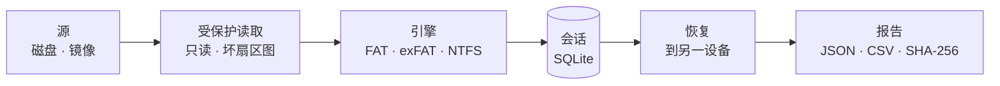

<div align="center">


# Rescyo 数据救援

**免费开源、绝不写入源磁盘的数据恢复工具。**

[](https://github.com/akk0sfx/Rescyo/actions/workflows/ci.yml)
[](LICENSE)
[](docs/roadmap.md)
[](#支持平台)
[](rust-toolchain.toml)

[English](README.md) · [Русский](README.ru.md) · **简体中文** · [日本語](README.ja.md) · [한국어](README.ko.md)

[快速开始](#快速开始) · [为什么选择 Rescyo](#为什么选择-rescyo) · [工作原理](#工作原理) · [文件系统](#文件系统) · [路线图](docs/roadmap.md)

</div>

---

> 本译文为机器辅助翻译，等待母语者审校。欢迎提交改进。

Rescyo 可从损坏、已格式化或部分无法读取的硬盘、存储卡和 U 盘中找回文件。它能一次性恢复完整的文件夹树、不限文件数量；会告诉你每个文件是如何拼装的、内容校验是否通过；并会小心对待濒临损坏的磁盘。单个便携程序即可运行于 Windows 7–11、Linux 和 macOS，命令行输出稳定的 JSON。

DMDE、R-Studio 和 UFS Explorer 的免费开源替代品。

> [!IMPORTANT]
> **Alpha 版（v0.1）。** 命令行可恢复 FAT、exFAT 和 NTFS，并通过了逐字节恢复测试，但尚无签名的二进制文件。请始终恢复到另一块磁盘；磁盘出现故障时请先制作镜像。

## 为什么选择 Rescyo

<table>
<tr>
<td width="50%" valign="top">

**从设计上只读**<br>
被恢复的磁盘仅以只读方式打开，并由类型系统保证：I/O 层没有写入操作。恢复的文件不能保存到同一物理设备——按设备检查，而不是按盘符。

</td>
<td width="50%" valign="top">

**如实标注每个文件**<br>
每个文件都标明其拼装方式（FAT 链、镜像 FAT、MFT 运行列表或“连续”推测）以及内容校验结果。满是垃圾数据的文件绝不会看起来和完好的文件一样。

</td>
</tr>
<tr>
<td valign="top">

**保护濒临损坏的介质**<br>
无法读取的扇区只读一次，记入坏扇区图，不再反复读取。磁盘状况恶化时，Rescyo 会暂停并建议先制作镜像。

</td>
<td valign="top">

**完整文件夹树，不设上限**<br>
一次恢复全部内容，包括父目录已损毁的文件夹（放入 `_LOST_FOLDERS`）。导入 DMDE 扫描日志，省去数小时的重新扫描。

</td>
</tr>
</table>

## 快速开始

尚未发布。从源码构建：

```sh
git clone https://github.com/akk0sfx/Rescyo.git
cd Rescyo
cargo build --release
```

计划中的 v0.1 命令行：

```sh
rescyo disks --json                              # 列出磁盘
rescyo scan /dev/sdb --session flash.db          # 查找卷和文件夹（只读）
rescyo ls flash.db --deleted --ext jpg,docx      # 浏览找到的内容
rescyo recover flash.db --to /mnt/backup/flash   # 复制出来，并生成 SHA-256 报告
```

## 工作原理



## 文件系统

| 文件系统 | 支持深度 | 版本 |
|---|---|---|
| FAT12、FAT16、FAT32 | 完整：丢失的卷、文件夹树、已删除文件 | v0.1 |
| exFAT | 完整 | v0.1 |
| NTFS | 完整：MFT、已删除文件；压缩、稀疏文件和 ADS 于 v0.2 | v0.1 |
| ext4、HFS+、APFS、Btrfs | 实验性 | v0.3–v0.4 |

## 支持平台

| 操作系统 | 架构 |
|---|---|
| Windows 10 / 11 | x64、arm64 |
| Windows 7 SP1 | x64、x86（独立构建） |
| Linux | x86_64、i686、aarch64、armv7、riscv64、loongarch64 |
| macOS 10.12+ | Apple 芯片、Intel |

## 许可证

GPL-3.0-or-later，见 [LICENSE](LICENSE)。本程序不提供任何担保。

本项目与 DMDE Software、R-Tools Technology 及 SysDev Laboratories 无任何关联；DMDE、R-Studio 和 UFS Explorer 是其各自所有者的商标。
