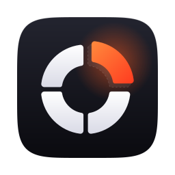

# Rescyo design system

One visual language for the GUI, the TUI, the website and the README. People open Rescyo when something has gone wrong, so the interface is calm, dense with facts, and loud only about two things: what is safe to do, and how trustworthy each recovered file is.

## Brand mark

A rescue ring that is also a disk platter cut into sectors, set on the diagonal. Three segments are in place; the top-right one, in rescue orange, is returning to its slot along the diagonal, whose dashed outline still shows where it belongs. It says what the tool does without a single letter, survives at 16 px, and stays clear of the usual "crosshair", "pie chart" and "cloud with arrow" icons.

| File | Use |
|---|---|
| `assets/brand/app-icon.svg` | App icon on the macOS 1024 grid (824 px body with continuous corners). Source for `.icns`, `.ico` and PNG sizes |
| `assets/brand/logo.svg` | The same icon cropped to its body: README, website, About window |
| `assets/brand/mark-dark.svg`, `mark-light.svg` | The mark without the tile, for dark and light grounds |
| `assets/brand/icon-layers/` | Background and foreground layers for Apple Icon Composer, so macOS 26 renders the icon in Liquid Glass |
| `assets/brand/png/` | Pre-rendered sizes 16–1024 |
| `assets/brand/src/build_brand.py` | Generates everything above. Edit the geometry there, never the SVGs by hand |

Rules: keep clear space equal to the gap between segments times four; never recolour the white segments, rotate the mark, or move the orange segment out of the top-right slot (its position is the meaning); on photos, use the tile, not the bare mark.

## Color

Dark is the default theme. Every color is a token; components never use literals.

| Token | Dark | Light | Role |
|---|---|---|---|
| `ink-0` | `#0A0A0F` | `#F4F4F7` | Window ground |
| `ink-1` | `#111119` | `#FFFFFF` | Panels, content area |
| `ink-2` | `#181822` | `#EEEEF3` | Raised rows, inputs |
| `ink-3` | `#22222E` | `#E3E3EB` | Hover, selection ground |
| `line` | `rgba(236,236,255,.08)` | `rgba(20,20,40,.10)` | Hairlines |
| `text` | `#F1F1F6` | `#12121A` | Primary text |
| `text-2` | `#A3A4B5` | `#55576A` | Secondary text |
| `text-3` | `#6C6D80` | `#8A8C9E` | Captions, disabled |
| `rescue` | `#FF5A1F` | `#E8480F` | The one accent: primary action, focus, brand |
| `ok` | `#3DD68C` | `#14965F` | Integrity *intact*, readable sectors |
| `warn` | `#F5C542` | `#A87700` | Integrity *partial*, *contiguous assumption* |
| `bad` | `#FF5C6C` | `#D92D40` | Integrity *damaged*, unreadable sectors |
| `info` | `#5AB8FF` | `#1E6FD0` | Mirror FAT, hints, neutral notices |

Rescue orange is reserved for the brand and the single primary action on screen. It never means "warning": that is `warn`, a yellow far enough from orange to read differently even for common color-vision deficiencies, and every state also has an icon and a word.

## Typography

| Role | Face | Use |
|---|---|---|
| Display | **Unbounded** 600/800 | Window titles on empty states, onboarding, website headings. Wide and geometric; used sparingly |
| Text | **Onest** 400/500/600 | All interface text |
| Data | **JetBrains Mono** 400/500 | Sizes, offsets, hashes, the hex view, and uppercase eyebrow labels |
| CJK | **Noto Sans SC / JP / KR** | Chosen by interface language (Han unification), shipped as optional language packs |

All four are SIL Open Font License and are bundled with the GUI, because the software renderer cannot rely on system fonts (Windows 7, live-USB). Scale (px): 11 · 12 · 13 · 15 · 18 · 24 · 32 · 48. Interface body is 13 px; eyebrow labels are 11 px mono, upper-case, letter-spacing 0.12 em.

Numbers line up: tabular figures everywhere sizes, counts and offsets appear. Sizes use binary units with a thin space (`4.2 MiB`), offsets are hex with a `0x` prefix.

## Shape and space

Radii: 6 (chips), 10 (controls), 14 (panels), 22 (windows and sheets). Spacing on a 4 px grid: 4 · 8 · 12 · 16 · 24 · 32 · 48. Hairlines instead of shadows inside the window; one soft shadow for floating sheets only.

## Materials per platform

The layout and tokens are identical everywhere; only the window material changes.

| Platform | Sidebar and toolbar | Content area |
|---|---|---|
| macOS 26+ (Apple silicon and Intel) | System **Liquid Glass** (`NSGlassEffectView`) behind transparent regions of the Slint window | Opaque `ink-1`, for legible dense data |
| macOS 11–15 | `NSVisualEffectView`, sidebar material | Opaque `ink-1` |
| Windows 11 22H2+ | **Mica** system backdrop (`DWMWA_SYSTEMBACKDROP_TYPE`) | Opaque `ink-1` |
| Windows 7–10, Linux, live-USB, RDP/AnyDesk | Solid `ink-0` | Solid `ink-1` |

Glass is decoration of the frame, never of data: tables, hex and previews always sit on an opaque surface. With "Reduce transparency" on (macOS/Windows), every platform falls back to the solid row.

## Signature components

- **Assembly chip**: how a file was put together. `FAT CHAIN` and `MFT` are neutral outlined chips; `MIRROR FAT` uses `info`; `CONTIGUOUS?` uses `warn` with a question mark, because it is a guess; `CARVED` is muted.
- **Integrity mark**: a 14 px glyph plus a word: ● intact (`ok`), ◐ partial (`warn`), ✕ damaged (`bad`), ○ unverified (`text-3`).
- **Sector strip**: a one-pixel-per-region bar across the top of a Session showing unread, readable and unreadable areas, with the current read head. It turns the Bad-sector map into something a frightened person can see at a glance.
- **Flow eyebrows**: the four real steps of a recovery are numbered in mono: `01 SOURCE`, `02 SCAN`, `03 BROWSE`, `04 RECOVER`. Numbers appear only where order is real.
- **Safety bar**: the recovery footer always shows the Target, the Preflight result and the free space before the primary button is enabled.

## Motion

120–200 ms, ease-out, for hover and selection; progress is continuous, never bouncing. Nothing pulses or blinks except a stalled-device warning. Honour reduced-motion settings.

## Voice

Plain and specific. Say what happened and what to do: "The boot sector is damaged; the backup copy at sector 6 was used." Never blame the user, never promise what the data cannot support, and say clearly when a case is hopeless (TRIM, hardware encryption, a dead controller).
